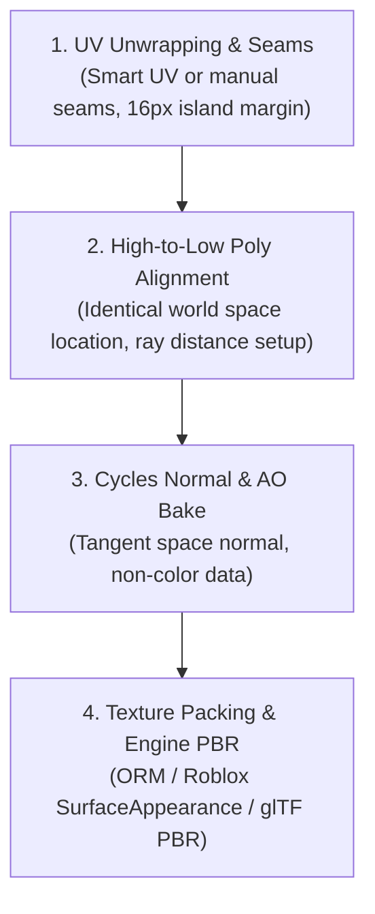

# Blender Texture Baking & PBR Materials Skill

This skill guides texture baking, UV atlas generation, and PBR material setup (Albedo, Normal, Roughness, Metallic, Ambient Occlusion) for real-time game assets using Blender MCP.

## Overview & Architecture

High-to-low poly baking transfers intricate sculpt details onto optimized in-game meshes:
1. **UV Unwrapping & Margins**: Generating clean, non-overlapping UV islands with adequate pixel margins (avoiding mipmap bleeding).
2. **Selected-to-Active Baking**: Setting up Cycles bake mode with Cage / Extrusion ray distance.
3. **Channel Packing**: Combining separate greyscale maps into standard engine formats (e.g. ORM: Occlusion in Red, Roughness in Green, Metallic in Blue).
4. **PBR Shader Graph Setup**: Wiring image textures into `BSDF_PRINCIPLED` with correct color spaces (`sRGB` for Base Color, `Non-Color` for Normal/Roughness/Metallic).

---

## 4-Step Baking & PBR Workflow



### Step 1: UV Unwrapping & Texel Density
- Ensure the low-poly mesh has a clean UV map:
  ```python
  bpy.ops.object.select_all(action='DESELECT')
  low_poly_obj.select_set(True)
  bpy.context.view_layer.objects.active = low_poly_obj
  bpy.ops.object.editmode_toggle()
  bpy.ops.mesh.select_all(action='SELECT')
  # Smart UV project with margin to prevent bleeding
  bpy.ops.uv.smart_project(angle_limit=66.0, island_margin=0.02)
  bpy.ops.object.editmode_toggle()
  ```

### Step 2: High-to-Low Poly Alignment
- Both High-Poly and Low-Poly models must share the exact same World Location, Rotation, and Scale.
- Low-poly should envelop the high-poly mesh closely. Use a ray extrusion distance of `0.02m` to `0.05m`.

### Step 3: Baking via Python in Cycles
Blender requires the Cycles engine for texture baking:
1. Switch render engine to `CYCLES` and device to `GPU` (fallback `CPU`).
2. Create an empty target image node in the low-poly material (`Non-Color` for Normal/AO).
3. Select high-poly, then low-poly (active).
4. Run `bpy.ops.object.bake(type='NORMAL')` and `bpy.ops.object.bake(type='AO')`.
- See the complete automated script in [bake_high_to_low.py](./scripts/bake_high_to_low.py).

### Step 4: Channel Packing & Target Engine Formats
- **Roblox Studio (SurfaceAppearance)**:
  - `ColorMap`: Base Color (RGB, sRGB) + Alpha (Transparency/Alpha Test)
  - `MetalnessMap`: Greyscale (Non-Color)
  - `RoughnessMap`: Greyscale (Non-Color)
  - `NormalMap`: Tangent Space Normal (Non-Color, OpenGL standard)
- **Unreal Engine 5 & Unity (ORM)**:
  - Red = Ambient Occlusion, Green = Roughness, Blue = Metallic.
- See detailed channel packing guides in [texture_channel_packing.md](./references/texture_channel_packing.md).

---

## References & Tools
- [Texture Channel Packing Standards](./references/texture_channel_packing.md)
- [Automated High-to-Low Baker Script](./scripts/bake_high_to_low.py)
