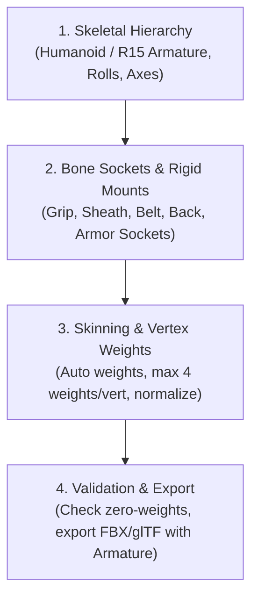

# Blender Character Rigging & Animation Skill

This skill guides the creation of humanoid armatures, mesh skinning, vertex weighting, equipment sockets, and mocap retargeting for game engines (Roblox R15, Unity Humanoid, Unreal Mannequin) via Blender MCP.

## Overview & Architecture

Characters and modular armor in game engines require strict skeletal hierarchies:
1. **Armature Creation**: Building clean humanoid bone hierarchies with consistent bone roll and axis orientation.
2. **Skinning (Weight Painting)**: Deforming soft meshes (tunics, skin, cloaks) with automatic weights and manual normalization.
3. **Rigid Piece Attachment (Sockets)**: Mounting rigid armor (helmets, pauldrons, shields, weapons) to parent bones or empty sockets without vertex deformation.
4. **Mocap Retargeting**: Converting BVH / FBX joint rotations into engine-compliant local rotations.

---

## 4-Step Character & Rigging Workflow



### Step 1: Humanoid & R15 Armature Structure
In `execute_blender_code`, build or verify the bone hierarchy:
- **Root**: `HumanoidRootPart` (facing `-Z`, `+Y` up, positioned at hip elevation or ground origin).
- **Spine**: `LowerTorso` -> `UpperTorso` -> `Head`.
- **Arms**: `UpperTorso` -> `LeftUpperArm` -> `LeftLowerArm` -> `LeftHand` (and symmetrical Right).
- **Legs**: `LowerTorso` -> `LeftUpperLeg` -> `LeftLowerLeg` -> `LeftFoot` (and symmetrical Right).
- See full hierarchy and joint offsets in [r15_bone_hierarchy.md](./references/r15_bone_hierarchy.md).

### Step 2: Sockets for Weapons & Armor
Never weld equipment permanently to the base mesh:
1. Create socket bones or Empties parented to respective skeleton joints:
   - `Socket_RightGrip`: child of `RightHand` (primary melee, spear, sling).
   - `Socket_LeftGrip`: child of `LeftHand` (bow grip, shield handle).
   - `Socket_HipR`: child of `LowerTorso` (sword scabbard).
   - `Socket_HipL`: child of `LowerTorso` (pugio dagger sheath).
   - `Socket_BackDiag`: child of `UpperTorso` (pilum, spear, stowed bow).
   - `Socket_BeltR` / `Socket_BeltL`: child of `LowerTorso` (flasks, plumbatae, pouches).
2. Align socket orientation so local forward (`-Z`) matches weapon forward.

### Step 3: Skinning & Vertex Weighting
1. **Parent Mesh to Armature**:
   ```python
   bpy.ops.object.select_all(action='DESELECT')
   mesh_obj.select_set(True)
   armature_obj.select_set(True)
   bpy.context.view_layer.objects.active = armature_obj
   bpy.ops.object.parent_set(type='ARMATURE_AUTO')
   ```
2. **Game Engine Weight Constraints**:
   - Real-time engines enforce a maximum of **4 bone influences per vertex**.
   - Limit weights in Python:
     ```python
     bpy.ops.object.select_all(action='DESELECT')
     mesh_obj.select_set(True)
     bpy.context.view_layer.objects.active = mesh_obj
     bpy.ops.object.vertex_group_limit_total(group_select_mode='ALL', limit=4)
     bpy.ops.object.vertex_group_normalize_all(group_select_mode='ALL', lock_active=False)
     ```

### Step 4: Rig Validation & Export
1. Run [rig_validator.py](./scripts/rig_validator.py) via `execute_blender_code` to detect unweighted vertices, unassigned vertex groups, and unapplied transforms.
2. Export with Armature:
   ```python
   bpy.ops.export_scene.fbx(
       filepath="path/to/character.fbx",
       use_selection=True,
       add_leaf_bones=False,
       bake_anim=True,
       axis_forward='-Z',
       axis_up='Y'
   )
   ```

---

## References & Tools
- [R15 Skeletal Hierarchy & Official Attachment Catalog](./references/r15_bone_hierarchy.md)
- [Rig & Weight Validator Script](./scripts/rig_validator.py)

## Equipment Socket & Skinned Armor Notes (Blender 5.2+)
- Rigid weapons/accessories parent directly to their target R15 bone (`parent_type = "BONE"` with `-bone.length` tail offset) and carry child socket Empties named from the official R15 catalog (`RightGripAttachment`, `GripAttachment`, `ForegripAttachment`, `HolsterBackAttachment`, `BodyBackAttachment`).
- Skinned armor (`chest`, `pauldron`, `greave`, `boot`, `gauntlet`) binds via `ARMATURE_AUTO` with a bone-proximity vertex-group fallback for thin headless plates, clamping every vertex to **max 4 bone influences normalized to 1.0**.
- Never set removed `mesh.use_auto_smooth = True` on Blender 5.2; keep `1 BU = 1 stud` and run `transform_apply(rotation=True, scale=True)` before exporting FBX/GLB + `_attachments.json` sidecar via `compile_asset_attach_bpy`.
