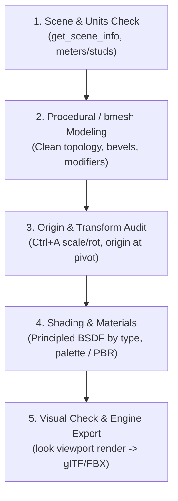

# Blender Game Asset Creation Skill

This skill guides the creation and optimization of game-ready 3D models directly in live Blender using the Blender Model Context Protocol (MCP) server.

## Overview & Architecture

Blender MCP connects to a live Blender session. You interact with it using:
- `call_mcp_tool(ServerName="blender", ToolName="get_addon_status", ...)`: Verifies Blender connection, version, and active asset libraries.
- `call_mcp_tool(ServerName="blender", ToolName="get_scene_info", ...)`: Inspects objects, materials, hierarchy, and active selection.
- `call_mcp_tool(ServerName="blender", ToolName="execute_blender_code", Arguments={"code": ...})`: Runs arbitrary Python code (`bpy`, `bmesh`, `mathutils`).
- `call_mcp_tool(ServerName="blender", ToolName="look", Arguments={"max_size": 512})`: Renders an interactive viewport screenshot to visually inspect modeling, topology, shading, and scale.
- `call_mcp_tool(ServerName="blender", ToolName="search_assets", ...)` / `import_asset`: Searches and imports CC0/PBR models from Poly Haven, Sketchfab, or Poly Pizza.
- `call_mcp_tool(ServerName="blender", ToolName="generate_3d", ...)`: Generates AI-assisted textured single meshes from text or reference images.

---

## 5-Step Game Asset Workflow



### Step 1: Inspect Scene & Initialize Target
Before modifying geometry, inspect the active scene:
1. Call `get_scene_info` to see existing objects, camera, and lighting.
2. In `execute_blender_code`, ensure metric units are configured:
   ```python
   import bpy
   bpy.context.scene.unit_settings.system = 'METRIC'
   bpy.context.scene.unit_settings.length_unit = 'METERS'
   bpy.context.scene.unit_settings.scale_length = 1.0
   ```

### Step 2: Construct Clean Geometry via `bmesh`
Always construct models using `bmesh` for robust, manifold geometry without relying on UI operators:
- **Never guess vertex soup blindly**: Use primitives (cubes, cylinders) and modify via extrusion, insetting, edge beveling, and loop cuts.
- **Poly Budgets**:
  - Tiny props / consumables (potions, coins, grenades): 200 – 800 triangles
  - Weapons & Shields (swords, bows, axes): 800 – 3,500 triangles
  - Modular building pieces / barricades: 300 – 2,500 triangles
  - Hero props / chests / machinery: 2,000 – 8,000 triangles
  - Humanoid characters / detailed armor sets: 5,000 – 20,000 triangles
- See detailed budgets in [game_asset_budgets.md](./references/game_asset_budgets.md).

### Step 3: Origin, Pivot & Transform Application
Real-time game engines require clean transforms:
1. **Apply Scale & Rotation**:
   ```python
   bpy.ops.object.select_all(action='DESELECT')
   obj.select_set(True)
   bpy.context.view_layer.objects.active = obj
   bpy.ops.object.transform_apply(location=False, rotation=True, scale=True)
   ```
2. **Pivot / Origin Placement**:
   - **Environment Props / Furniture / Buildings**: Origin at bottom center (`Z = 0`).
   - **Weapons / Handheld Tools**: Origin at the grip/handle socket point.
   - **Shields**: Origin at the forearm grip bar.
   - **Projectiles (Arrows, Javelins)**: Origin at the center of mass or tip, oriented along `-Z` forward.

### Step 4: Shading & Materials (Principled BSDF)
Blender materials must be robust against localization:
- **CRITICAL RULE**: Look up shader nodes by `.type == 'BSDF_PRINCIPLED'`, NEVER by name `"Principled BSDF"` (names are localized in German, French, etc.):
  ```python
  mat = bpy.data.materials.new(name="M_PropWood")
  mat.use_nodes = True
  nodes = mat.node_tree.nodes
  principled = next(n for n in nodes if n.type == 'BSDF_PRINCIPLED')
  # Assign Base Color (RGBA)
  principled.inputs['Base Color'].default_value = (0.35, 0.20, 0.10, 1.0)
  principled.inputs['Roughness'].default_value = 0.8
  principled.inputs['Metallic'].default_value = 0.0
  ```
- **Blender 5.2+ Normal Smoothing**: `mesh.use_auto_smooth` was removed in Blender 4.1+/5.2. Use smooth shading (`bpy.ops.object.shade_smooth()`) paired with sharp edges / `WeightedNormal` modifier rather than setting `obj.data.use_auto_smooth = True`.
- **Principled BSDF Lookup**: Always resolve the shader node via `node.type == "BSDF_PRINCIPLED"` (never hardcode `"Principled BSDF"` key name), and use `bpy.ops.wm.obj_import` with `bpy.ops.import_scene.obj` fallback.
- **Roblox Socket Empties & Sidecar Export (`compile_asset_attach_bpy`)**: Create R15-named Empty sockets (`GripAttachment`, `ForegripAttachment`, `HolsterBackAttachment`, `BodyBackAttachment`, etc.), scale cleanly to R15 stud proportions (`1 BU = 1 stud`), apply transforms, and export `.fbx`/`.glb` + `<prop>_attachments.json` (`sharp.attachment_sidecar.v1`) for `AttachmentEngine`. See [Blender Prop & Socket Export Guide](./references/blender_prop_export.md).

### Step 5: Visual Check & Export
1. **Visual Verification**: Call `look` tool to verify the asset with lighting and framing.
2. **Audit Geometry**: Run [audit_game_asset.py](./scripts/audit_game_asset.py) via `execute_blender_code` to ensure 0 non-manifold edges, 0 zero-area faces, and verified triangle count.
3. **Export Formats**:
   - **glTF 2.0 (`.glb`)** (Universal: Roblox, Godot, Web, Unity):
     ```python
     bpy.ops.export_scene.gltf(
         filepath="path/to/asset.glb",
         export_format='GLB',
         use_selection=True,
         export_apply=True,
         export_normals=True
     )
     ```
   - **FBX (`.fbx`)** (Unreal Engine, Unity, Roblox Studio):
     ```python
     bpy.ops.export_scene.fbx(
         filepath="path/to/asset.fbx",
         use_selection=True,
         apply_scale_options='FBX_SCALE_ALL',
         axis_forward='-Z',
         axis_up='Y'
     )
     ```

---

## Detailed References & Recipes

- [Game Asset Poly & Texture Budgets](./references/game_asset_budgets.md)
- [bpy Procedural Modeling Recipes & Snippets](./references/bpy_recipes.md)
- [Asset Quality Audit Script](./scripts/audit_game_asset.py)
