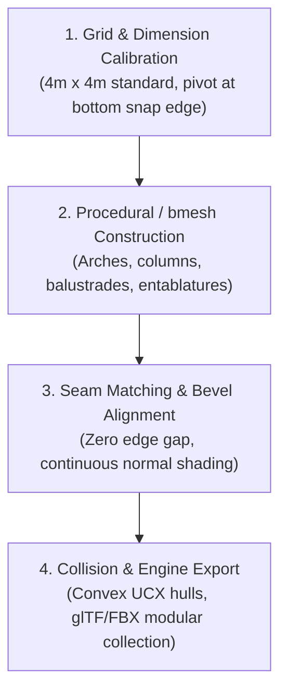

# Blender Modular Architecture & Level Design Skill

This skill guides the construction of grid-aligned, modular 3D architectural kits for level design and city environments (such as Roman cities, temples, insulae, cardo/decumanus avenues, walls, and arenas) using Blender MCP.

## Overview & Architecture

Modular architecture relies on strict grid dimensions and seam alignment:
1. **Grid Metrics**: Standardize module widths, heights, and depths (e.g. 2m, 4m, 8m wall spans).
2. **Pivots & Snap Points**: Place origin points at corner snap points or center-bottom for seamless tiling without gaps.
3. **Seam & Bevel Matching**: Maintain identical edge profiles along connection boundaries so adjacent modules tile without light leaks.
4. **Multi-Material Masking**: Group faces by material ID (e.g. Travertine stone, terracotta tile, marble trim, wood timber).

---

## 4-Step Modular Kit Workflow

### Step 1: Grid & Dimension Standard
Always model architectural pieces to a fixed module grid:
- **Wall Standard**: `4.0m` width, `4.0m` height (or `3.0m` residential floor height).
- **Doorway / Archway**: `2.0m` width, `3.2m` clearance height.
- **Street / Road Width**: `8.0m` (minor street) or `16.0m` (Cardo / Decumanus Maximus).
- **Column Spacing**: `3.0m` to `4.5m` intercolumniation.
- **Pivot Placement**: Bottom-center `(0, 0, 0)` for freestanding columns and monuments; bottom-left `(-width/2, 0, 0)` or center-rear for wall panels.

### Step 2: Procedural Classical Roman Components
See [roman_architectural_orders.md](./references/roman_architectural_orders.md) for proportions:
- **Columns**: Fluted or smooth shaft (12–16 radial segments for game models), Attic base, and Doric/Tuscan/Corinthian capitals.
- **Roman Arches**: Semi-circular arches extruded from radial bmesh fans with distinct keystone (`voussoir`) blocks.
- **Entablature**: Continuous horizontal architrave, frieze, and projecting cornice.

### Step 3: Collision Hulls & Occlusion
Game engines need simplified collision for architectural structures:
- Add simple convex box colliders named `UCX_<PieceName>_01`, `UCX_<PieceName>_02`.
- For arched walls, use three boxes: two side pillars and one top lintel block.

### Step 4: Batch Export of Modular Kits
Export all modular pieces as separate `.glb` or `.fbx` assets into the project's models directory using [generate_modular_wall.py](./scripts/generate_modular_wall.py).

---

## References & Tools
- [Classical Roman Architectural Orders](./references/roman_architectural_orders.md)
- [Procedural Roman Arch Wall Generator Script](./scripts/generate_modular_wall.py)
