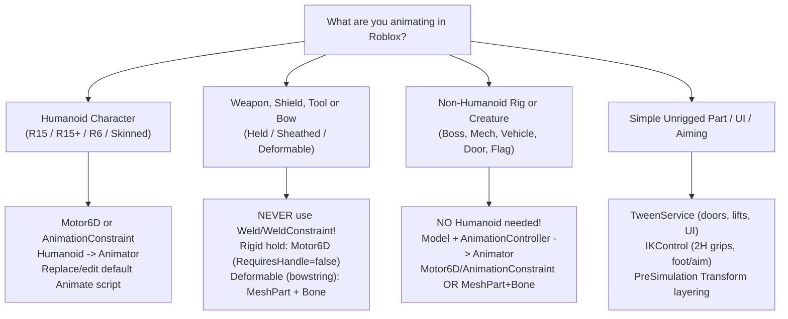
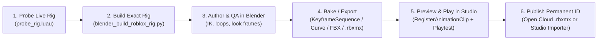

# Roblox Studio Universal Animation Skill

End-to-end pipeline for animating **anything** in Roblox Studio — humanoids (`R15`, `R15+`, `R6`, custom skinned avatars), held weapons/shields/tools (rigid or deformable), non-humanoid articulated rigs (`AnimationController` + `Animator`), and procedural/tweened world objects — authored primarily via **Blender** (`sharp_blender_setup` + `sharp_blender_rig_and_anim` / **Blender MCP** and Roblox native **`generate_animation`** tracks) and verified in **Roblox Studio** (`sharp_rig_and_animation`).

For character mesh skinning and socket placement basics, combine with [blender-character-rigging](../blender-character-rigging/SKILL.md) and [blender-game-assets](../blender-game-assets/SKILL.md).

---

## 1. Decision Tree: Choose the Right Rig & Animation Path



### Authoring Engine Selection
1. **Blender + Sharp Blender Pipeline (Primary)**: Call `sharp_blender_setup` to detect or auto-install Blender 5.2+ and the `mcp-for-blender` addon (`blender --background` headless fallback included), then drive `sharp_blender_rig_and_anim` or `execute_blender_code` + `look(mode="frames")` for full control over keyframing, IK constraints, cyclic walk/run loops, world-locked shields, 2-handed grips, Mixamo/BVH retargeting, and exact joint math. See [blender_export.md](./references/blender_export.md).
2. **Roblox Studio Native (`generate_animation` / `Animation Editor`)**: Use Studio's `generate_animation` for fast text-prompt R15+ drafts or upscaling legacy R6 clips to R15, or Studio's Live Animation Creator for `.mp4`/`.mov` motion capture.

---

## 2. Core End-to-End Workflow (Blender MCP -> Roblox Studio MCP)



### Step 1: Probe the Live Roblox Rig (Zero-Guesswork Geometry)
Never guess bone offsets or joint orientations for custom characters, shields, or creatures:
1. Run `sharp_rig_and_animation(mode="probe", ...)` or [probe_rig.luau](./scripts/probe_rig.luau) via `execute_luau` (`datamodel_type="Edit"`). Select the target `Model` in Studio (or set `TARGET_PATH`, or leave empty to dump a fresh blocky R15 rig).
2. Save the returned JSON to `<project>/rig_spec.json` (contains exact `BasePart` sizes/CFrames, `AnimationConstraint` / `Motor6D` / `Bone` rest frames, and grip `Attachment`s).

### Step 2: Build the Exact Blender Rig & Attach Weapons/Shields
In Blender (`sharp_blender_rig_and_anim` or `execute_blender_code`), resolve the skill scripts folder portably using `$SHARP_SKILLS_DIR` with a `Path.home()` fallback:
```python
import os
import sys
from pathlib import Path

SKILLS_ROOT = Path(os.environ.get("SHARP_SKILLS_DIR") or (Path.home() / ".gemini" / "config" / "skills"))
SKILLS_SCRIPTS = str(SKILLS_ROOT / "roblox-animation" / "scripts")
if SKILLS_SCRIPTS not in sys.path:
    sys.path.insert(0, SKILLS_SCRIPTS)
```
Build from `rig_spec.json` (or built-in `R15` / `R6` presets) using [blender_build_roblox_rig.py](./scripts/blender_build_roblox_rig.py):
- Creates a 1:1 armature where every bone's rest frame equals `Part0_rest * C0` (or `Bone.WorldCFrame` for skinned meshes), conjugated into Blender space (`1 BU = 1 stud` by default).
- Optionally spawns lightweight bone-parented **proxy meshes** and **non-deforming `IK_*` helper bones** (`use_deform = False`) so IK and constraints never pollute exports.
- Mount weapon/shield meshes or proxies onto `RightHand` / `LeftHand` / `Socket_*` so collisions, facing, and 2-handed grips are visible live.

### Step 3: Author Animations & Visually Verify in Blender
Use [blender_anim_helpers.py](./scripts/blender_anim_helpers.py) (safe for **Blender 5.2 slotted actions / channelbags** as well as legacy actions):
- **Locomotion (Walk / Run / Idle)**: Animate `LowerTorso` bob/sway/tilt and full-body limb arcs; keep `HumanoidRootPart` stationary for standard in-place locomotion; call `make_seamless_loop()` so frame 1 and frame N match cleanly.
- **Shields & Two-Handed Weapons**: Use `solve_world_locked_hand()` to keep a tower shield vertical/facing forward while arms swing, or `attach_two_handed_ik()` to keep the off-hand locked to a weapon grip socket across frames.
- **Markers / Events**: Add timeline markers via `add_animation_marker(rig, frame, "HitStart")` for exact combat hitboxes, arrow release, or footstep SFX.
- **Visual QA before exporting**: Call Blender MCP `look(target=[rig.name], mode="frames", frame_count=6, shading="solid")` (or `"xray"`). Fix clipping, backward elbows/knees, or floating feet before moving to Studio!

### Step 4: Bake & Export (Dual Pipeline)
Use [blender_bake_to_roblox.py](./scripts/blender_bake_to_roblox.py) and/or [blender_export_roblox_fbx.py](./scripts/blender_export_roblox_fbx.py):
- **Direct Studio Bridge (Fastest Iteration)**:
  - Evaluates the Blender **depsgraph** (`arm_obj.evaluated_get(depsgraph)`) at each sampled frame so **keyframes + IK + constraints + NLA** all bake cleanly into Roblox joint space `(position_studs, rotation_matrix)`.
  - Emits:
    1. `clips.json` (portable clip data)
    2. **Luau builder (`KeyframeSequence` or modern `CurveAnimation`)** for `execute_luau`
    3. **`.rbxmx` XML** ready for Open Cloud `assetType="Animation"` upload!
- **FBX Export (For Studio 3D Importer / Skinned Meshes)**:
  - Run `blender_export_roblox_fbx.py` with Roblox's verified settings: `apply_scale_options='FBX_SCALE_UNITS'`, `add_leaf_bones=False`, `use_armature_deform_only=True`, `bake_anim_simplify_factor=0.0`, `bake_anim_use_nla_strips=False`, `bake_anim_use_all_actions=False`.

### Step 5: Preview, Verify & Wire in Roblox Studio
1. Execute the generated Luau builder (or run [studio_test_anim.luau](./scripts/studio_test_anim.luau)) via `execute_luau` (`datamodel_type="Edit"`).
2. `AnimationClipProvider:RegisterAnimationClip(clip)` returns an immediate testable ID (works in Edit & Playtest for **both `KeyframeSequence` and `CurveAnimation`** without cloud upload!). Also saves a copy under `ServerStorage.RBX_ANIMSAVES` for the Studio Animation Editor.
3. For permanent `rbxassetid://<id>` assets:
   - Upload the generated **`.rbxmx`** via `open_cloud_invoke` (`POST /assets/v1/assets`, `assetType: "Animation"`, `contentType: "model/x-rbxm"`). Note: Open Cloud **rejects `.fbx`/`.glb` for `assetType="Animation"`** — use `.rbxmx`/`.rbxm` for Open Cloud or Studio's Animation Editor / 3D Importer for `.fbx`!
4. Verify in live Playtest (`start_stop_play` -> `Play` -> `screen_capture` + `execute_luau` checking `Animator:GetPlayingAnimationTracks()` and marker callbacks).

---

## 3. Critical Rules & Common Pitfalls

1. **`Weld` / `WeldConstraint` cannot animate**: Always attach animated weapons/shields with `Motor6D` (`Tool.RequiresHandle = false` on equip, or replace `RightGrip`) or author deformable props (`MeshPart` + `Bone`).
2. **Blender 5.2 removed `action.fcurves`**: Always read/write F-Curves through `action.layers[0].strips[0].channelbag(slot).fcurves` or `action.fcurve_ensure_for_datablock(...)` (handled automatically in `blender_anim_helpers.py`).
3. **`pose_bone.matrix_basis` ignores IK/constraints**: Always read `(parent_pose.matrix @ rest_rel).inverted() @ pb.matrix` from `arm_obj.evaluated_get(depsgraph)` when baking.
4. **Fighting Roblox's default `Animate` script**: If default `Idle`/`Walk` tracks keep playing (`Priority=Core/Idle/Movement`), either edit `Animate`'s child `Animation` IDs inside `StarterCharacterScripts.Animate` or disable/destroy `Animate` and drive all locomotion via `Animator:LoadAnimation()` with proper priorities (`Idle` < `Movement` < `Action`..`Action4`).
5. **Deprecated APIs to avoid**: Never call `Humanoid:LoadAnimation()`, `AnimationController:LoadAnimation()`, or `KeyframeSequenceProvider:RegisterKeyframeSequence()`. Always use `Animator:LoadAnimation()` and `AnimationClipProvider:RegisterAnimationClip()`.
6. **Replication**: Play **player character** animations on the **Client** (`LocalScript` — engine replicates automatically); play **server NPC / world object** animations on the **Server** (`Script`).

---

## 4. References & Scripts Index

- **Rigging & Math**: [rig_types_and_math.md](./references/rig_types_and_math.md) — R15, R15+, R6, Skinned Meshes, `AnimationConstraint` vs `Motor6D`, exact CFrame math.
- **Weapons, Shields & Tools**: [weapons_shields_and_tools.md](./references/weapons_shields_and_tools.md) — `Motor6D` tool grips, sheathing, 2H IK, world-locked shields, deformable bowstrings.
- **Non-Humanoid & Procedural**: [non_humanoid_and_procedural.md](./references/non_humanoid_and_procedural.md) — `AnimationController`, creatures/doors/vehicles, `TweenService`, `IKControl`, `PreSimulation` layering, `generate_animation`.
- **Playback & Runtime Luau**: [playback_and_runtime_luau.md](./references/playback_and_runtime_luau.md) — `CurveAnimation` vs `KeyframeSequence`, priorities, upper-body masks, `KeyframeMarker`, `Animate` replacement, replication.
- **Blender 5.2 Export & Sharp Auto-Setup**: [blender_export.md](./references/blender_export.md) — Slotted actions, retargeting, Roblox FBX checklist, `sharp_blender_setup`, and socket/headless execution.
- **Publishing & Open Cloud**: [publishing_and_open_cloud.md](./references/publishing_and_open_cloud.md) — `.rbxmx` XML format, `open_cloud_invoke` (`assetType="Animation"`), permissions.
- **Scripts**:
  - [probe_rig.luau](./scripts/probe_rig.luau)
  - [blender_build_roblox_rig.py](./scripts/blender_build_roblox_rig.py)
  - [blender_anim_helpers.py](./scripts/blender_anim_helpers.py)
  - [blender_bake_to_roblox.py](./scripts/blender_bake_to_roblox.py)
  - [blender_export_roblox_fbx.py](./scripts/blender_export_roblox_fbx.py)
  - [studio_test_anim.luau](./scripts/studio_test_anim.luau)

## Animation Quality & Equipment Attachment Pipeline

- **Playback Standards**: Always load clips via `Animator:LoadAnimation(anim)` (never `Humanoid:LoadAnimation`), cache `AnimationTrack` instances per `(Animator, key)` using weak keys (`_SharpTrackCache`), and drive hitboxes/SFX from `KeyframeMarker` events. See [Animation Quality Checklist](./references/animation_quality_checklist.md).
- **Quality Presets & Auditor (`RigAnimationEngine`)**:
  - `list_procedural_presets()` / `generate_procedural_preset(...)`: non-robotic clips (`idle_breathing`, `walk`, `run`, `sword_combo_3hit`, `bow_draw_release`, `shield_block`, `hit_react`, `death`, `emote_wave`) authored with anticipation, overshoot, follow-through, and phase-lagged secondary joints.
  - `analyze_clip(...)`: detects 3D FK foot sliding, loop seam mismatch, single-frame rotation pops / over-speed joints, missing root/pelvis motion, and priority/loop issues.
- **Equipment Attachment (`AttachmentEngine`)**: Attaches accessories (`RigidConstraint`), `Tool.Grip`, animatable `Motor6D` weapons (with `RightGrip` cleanup and matching `C0`/`C1`), back/hip holsters, multi-slot armor sets, off-hand `IKControl` (guarded via `pcall`), and read-only `verify` audits, consuming `<prop>_attachments.json` sidecars from Blender `compile_asset_attach_bpy`. See [R15 Equipment Attachment Guide](./references/equipment_attachment_guide.md).
