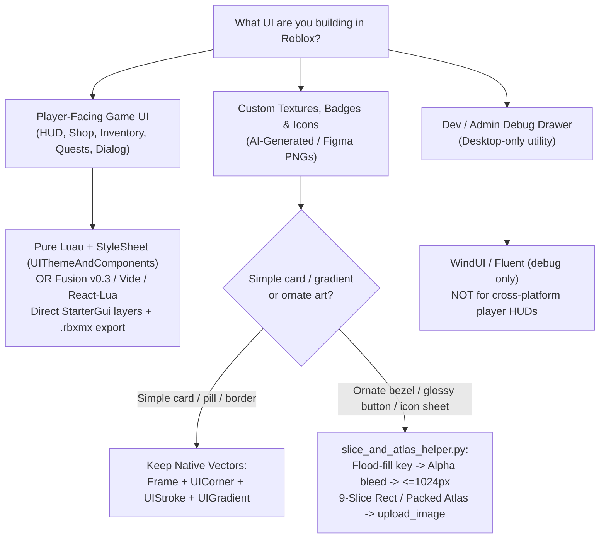
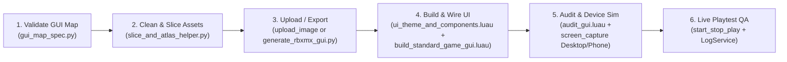

# Roblox Studio Cross-Platform GUI Skill

End-to-end pipeline for designing, styling, asset-prepping, building, and verifying **production Roblox game GUIs** across **Desktop**, **Mobile**, and **Console** — combining native **`StyleSheet`/`StyleRule` tokens**, **clean 9-slice & alpha-bled icon atlases**, **3D `ViewportFrame` previews**, **accessible `ModalManager` / `Tooltip` / `Toast` UX**, and **automated Studio Device Simulator & Playtest verification**.

---

## 1. Decision Tree: UI Stack, Assets & Layout Path

### Authoring Stack Selection
1. **Pure Luau + `StyleSheet` (Primary Recommended Path)**: Zero external dependencies, executes directly via `Roblox_Studio:execute_luau`, exports cleanly to `.rbxmx` (`generate_rbxmx_gui.py`), and uses engine-native `:Hover`/`:Press` transitions.
2. **Reactive Frameworks (Optional)**: Use **Fusion v0.3.0** (`scoped()`, `Value`, `Computed`, `Spring`, `peek()`, `use()`), **Vide v0.4.1** (`source()`, `derive()`, `effect()`), **Onyx-UI v1.0.4**, or **React-Lua v17.2.1** (`@jsdotlua/react`), plus **TopbarPlus v3.5.0** and **Lucide Roblox** (`latte-soft/lucide-icons@0.1.2`) when projects already use Wally/module graphs. See [opensource_templates_and_frameworks.md](./references/opensource_templates_and_frameworks.md).
3. **Standalone Skills or Sharp Surgical Pipeline**: Standalone `~/.gemini/config/skills/roblox-gui/` + `Roblox_Studio` MCP handles building, uploading, Device Simulator checks, and Playtesting directly; when running with **Sharp** (`SharpBridgePlugin.rbxmx`), use `sharp_gui_slice_and_pack`, `sharp_gui_build`, `sharp_gui_inspect`, `sharp_gui_patch`, and `sharp_visual_diff` for atomic undo, `SharpHandle` surgical patching, and RGBA visual diffing.

---

## 2. Core End-to-End Pipeline (Design -> Assets -> Studio -> QA)

### Step 1: Design System Synthesis & GUI Layer Mapping ("Anti-Slop")
Never ship generic dark-navy + flat default-blue widgets or unstyled rectangles:
- **Design System (`DesignEngine` / `sharp_design_system`)**: Generate a deterministic per-title/per-seed palette (`analogous`, `triadic`, `split_complementary`, `tetradic` across 6 curated genre presets: `candy_simulator`, `anime_neon`, `cozy_pastel`, `scifi_holo`, `arcade_pop`, `rpg_arcane`), differentiated radii (`Badge < Button < Panel`), outer `OutlineInk` + inner highlight strokes, multi-stop diagonal glossy `UIGradient` recipes, and WCAG 2.1 contrast guarantees (`>= 4.5:1` text, `>= 3.0:1` UI/icons). Run `lint_design()` to catch flat single-color buttons, default blue/gray slop, `<3` distinct hues, missing press/hover states, `<44px` touch targets, emoji-as-icon, and uniform corner radii.
- **Layer Architecture**: Validate your `ScreenGui` architecture with [gui_map_spec.py](./scripts/gui_map_spec.py) (`get_standard_gui_map()`, `validate_gui_map()`, `generate_starter_gui_manifest()`) — unique `DisplayOrder` Z-layers (`0..1000`), `ResetOnSpawn = false`, `ZIndexBehavior = Enum.ZIndexBehavior.Sibling`, explicit `ScreenInsets`, `min_touch_target_px >= 44`.

### Step 2: Generate & Process AI UI Images / Figma PNGs (`<= 1024x1024`)
When generating custom UI frames, tintable buttons, loading backdrops, or arbitrary `rows × cols` icon sheets with an AI image generator, use the palette-locked prompt templates in [ai_image_prompt_templates.md](./references/ai_image_prompt_templates.md) (or `DesignEngine.build_image_prompt_batch()` / `python slice_and_atlas_helper.py prompt-template --kind <9slice_panel|9slice_tint_button|icon_grid_2x2|loading_backdrop|...>`):
- **6 Golden Prompting Rules**: (1) `flat 2D orthographic front-facing, zero perspective tilt`, (2) `isolated on a single flat uniform solid key background ({KEY_BG_HEX})` (never fake checkerboard), (3) `ornate details strictly in the 4 outer corners; straight uniform middle 56% span` for 9-slice stretching, (4) `neutral white/silver grayscale` for `ImageColor3`-tintable buttons, (5) `invisible R×C grid with wide padding, NO dividing lines` for icon sheets, and (6) `strictly no text or numbers`, locked to `{PALETTE_HEXES}` + `{STYLE_SIGNATURE}` + anti-slop negative prompts.
- **9-Slice Frames & Tintable Buttons**: `prepare_nine_slice_png()` (`cli: prepare-9slice`) runs perimeter flood-fill background removal (`remove_border_background`), tight auto-crop (`crop_to_alpha_bbox`), `<= 1024x1024` downscale clamping (`fit_max_dimension`, keeping `SliceCenter` accurate on upload), 1–2px RGB edge dilation (`alpha_bleed_rgba`) to stop black halos, and corner-safe `detect_nine_slice_center()`.
- **Generalized `R×C` Icon Sheets & Atlases**: `split_grid_and_pack_atlas()` (`cli: split-atlas --rows R --cols C --names "..."`) proportionally splits any arbitrary `R×C` grid (`2×2`, `3×3`, `4×4`, etc.), flood-fill keys every cell, tight-trims transparent padding, alpha-bleeds edges, auto-fits cell sizing within `<= 1024×1024` with `4px` gutters, and emits `ImageRectOffset` / `ImageRectSize` (`compute_atlas_uvs`).

### Step 3: Upload Textures or Export `.rbxmx`
- **`Roblox_Studio:upload_image`**: Accepts HTTP/HTTPS URLs only (for local PNGs, serve transiently on `http://127.0.0.1:<port>/...` or use Figma MCP URLs) -> returns `rbxassetid://<id>`.
- **`Roblox_Studio:open_cloud_invoke`**: Uploads approved local files via `POST /assets/v1/assets`.
- *(Do NOT use `store_image` or `generate_texture` for 2D `ScreenGui` textures — those are for 3D AI mesh generation only.)*
- Offline `.rbxmx` & Luau generation: run [generate_rbxmx_gui.py](./scripts/generate_rbxmx_gui.py) (`generate_standard_gui_rbxmx()`, `generate_standard_gui_luau()`).

### Step 4: Build & Wire UI in Studio (`execute_luau`)
1. Install [ui_theme_and_components.luau](./scripts/ui_theme_and_components.luau) as a `ModuleScript` at `ReplicatedStorage.UIThemeAndComponents` (and call `UIKit.ApplyDesignSystem(ds)` or pass `design_system` to `sharp_gui_build` before `BuildStyleSheet`).
2. Optionally pass uploaded asset IDs in `_G.ROBLOX_GUI_ASSETS` (otherwise glossy vector components, stacked `UIStroke` + diagonal `UIGradient` + `ShineSweep` + `pcall(UIShadow)` + `SunburstRays`, and 3D `ViewportFrame` fallbacks render crisply offline).
3. Run [build_standard_game_gui.luau](./scripts/build_standard_game_gui.luau) via `execute_luau(datamodel_type="Edit")` to build all `StarterGui` layers, `ReplicatedStorage.UIStyles`, procedural 3D preview models (`GuiPreviewModels`), and `StarterPlayerScripts.StandardGuiController`.

### Step 5: Audit, Surgical Patch, Visual Diff & Playtest
1. **Surgical Inspection (`sharp_gui_inspect`)**: Inspect live `StarterGui` / `PlayerGui` trees cleanly without destructive rebuilds. Assigns/preserves persistent `"SharpHandle"` GUIDs (`sh_<guid>`), reads `AbsolutePosition` / `AbsoluteSize` / `AbsoluteContentSize`, inspects active `StyleLink` / `StyleSheet` / `StyleRule` selectors, and reports `IsPropertyModified` overrides that could block StyleSheet inheritance.
2. **Non-Destructive Patching (`sharp_gui_patch`)**: Apply targeted edits by `sharp_handle` (`SharpHandle`) or instance `path` (`set_properties`/`setProperties` with typed `UDim2`/`Color3`/`Enum.*` decoding, `reset_properties`/`resetProperties` via `ResetPropertyToDefault` to restore `StyleRule` inheritance, and `style_rule_updates`/`styleRuleUpdates`). Backed by `SharpUndo` readback verification (auto-cancels recording if readback mismatches).
3. **Audit & Device Simulator**: Run [audit_gui.luau](./scripts/audit_gui.luau) (or `sharp_audit_all`) in **Edit** mode (`StarterGui`) and **Play** mode (`PlayerGui`) — checks `ResetOnSpawn`, `ZIndexBehavior`, `TopbarInset` overlap, `>= 44x44px` touch hitboxes, viewport/safe-area clamping, mobile thumbstick/jump overlap, `StyleRule.SelectorError`, and `CanvasGroup` budget. Use Studio's Device Simulator (`rbx-device-simulator-lua` or `SharpGuiTools.deviceSim`) + `screen_capture` across Desktop (`1920x1080`) and Phone (`844x390`).
4. **Pixel Visual Diff (`sharp_visual_diff`)**: Compare before/after screenshots (`Pillow` + `numpy` RGBA diffing with blank-frame detection, `changed_ratio`, `max_channel_delta`, `diff_bbox`, and optional diff image) to verify every layout patch empirically.
5. **Live Playtest**: Enter live Playtest (`start_stop_play`), exercise modals (`Shop` -> `ConfirmDialog` -> `Toast`, `Inventory` 3D `ViewportFrame`, `Quests` claim, `IndexCodes` `"LAUNCH2026"`, `Settings` `UIDragDetector` sliders, `NpcDialog` typewriter) and verify `LogService:GetLogHistory()` shows zero errors/warnings.

---

## 3. Standard Game GUI Mapping Summary

| `DisplayOrder` | `ScreenGui` | `ScreenInsets` | Contents |
| :---: | :--- | :--- | :--- |
| `0` | `BackdropVignetteGui` | `None` | Non-interactive (`Active = false`) damage/low-HP vignette |
| `10` | `MainHudGui` | `CoreUISafeInsets` | `PlayerStatus` (HP/XP/Lv), `CurrencyBar`, `SideRail`, `ActionHotbar`, `ObjectiveTracker` |
| `20` | `TopbarWidgetsGui` | `TopbarSafeInsets` | Slim status pill inside topbar gap (or TopbarPlus v3.5.0) |
| `30` | `ContextualPromptGui` | `CoreUISafeInsets` | Custom `ProximityPrompt` / `[E]` contextual prompt |
| `49` | `ModalBackdropGui` | `None` | Full-bleed dim `Scrim` behind notches while a modal is active |
| `50` | `ModalMenusGui` | `CoreUISafeInsets` | Single-active Modal Stack: **Shop**, **Inventory**, **Quests**, **IndexCodes**, **Settings** |
| `65` | `NpcDialogGui` | `CoreUISafeInsets` | Speaker `ViewportFrame` 3D bust, `MaxVisibleGraphemes` typewriter, choices |
| `80` | `ConfirmDialogGui` | `CoreUISafeInsets` | High-priority blocking confirmation (`SelectionGroup = true`) |
| `90` | `FloatingTooltipGui` | `CoreUISafeInsets` | Viewport-clamped hover/selection tooltip (`Active = false`) |
| `100` | `ToastNotificationGui` | `CoreUISafeInsets` | FIFO non-blocking toast stack (max 3 visible) |
| `1000` | `LoadingTransitionGui` | `None` | `ReplicatedFirst` splash / teleport curtain (`LoadingTransitionTemplate`) |

---

## 4. Critical Rules & Common Pitfalls

1. **Nested `ScreenGui` breaks `ResetOnSpawn = false`**: Every persistent `ScreenGui` MUST be a direct child of `StarterGui` (never inside a `Folder`).
2. **`StyleRule` state is `:Press`, NOT `:Pressed`**: Matches `Enum.GuiState` (`:Hover`, `:Press`, `:NonInteractable`). Inspect `rule.SelectorError` after setting selectors.
3. **Studio 9-Slice Editor vs `SliceCenter`**: Studio shows inward edge offsets `(L, T, R, B)`, whereas `SliceCenter` is `Rect.new(L, T, W - R, H - B)`. Always keep 9-slice/atlas sources `<= 1024x1024` so Roblox downscaling never shifts pixel coordinates.
4. **Prevent Black Halos on Alpha PNGs**: Always run RGB alpha-bleed dilation (`alpha_bleed_rgba`) and add `2–4px` gutters around atlas tiles before uploading.
5. **`CanvasGroup` Budget & `Sibling` Requirement**: `CanvasGroup` REQUIRES ancestor `ZIndexBehavior = Enum.ZIndexBehavior.Sibling`, caps hardware buffers at **2048x2048** (**1024x1024** low-end), and **renders blank** if client memory budget is exceeded — reserve it for transient fades, never per scrolling list card.
6. **Touch Target Minimum (`>= 44x44px` physical)**: When applying `UIScale` on compact phones (`0.86..0.92`), design interactive controls `>= 52px` (`52 * 0.86 = 44.7px >= 44px`) and avoid bottom-left `DynamicThumbstick` / bottom-right `TouchJumpButton`.
7. **Legacy `IgnoreGuiInset` & Safe Areas**: `IgnoreGuiInset = true` maps to `DeviceSafeInsets` (NOT `None`) and is not saved; always set `ScreenGui.ScreenInsets` explicitly.
8. **NO DEAD UI — Live Runtime Reactivity & Player Equipment (`NO-DEAD-UI`)**: Never leave static mockup UI bars or unequipped weapon models only on showcase rigs. Every HUD element MUST be wired to live runtime signals (`Humanoid.HealthChanged` for HP bars, `RunService.RenderStepped` + `RemoteEvent` state sync for charge/cooldown/reload/ammo, `Activated`/`UserInputService` for buttons/hotkeys), and requested playable weapons/items MUST be placed in `StarterPack` (`Tool` + `Humanoid:EquipTool`) so players receive and hold them on spawn.

---

## 5. References & Scripts Index

- **GUI Mapping & Safe Zones**: [gui_mapping_and_architecture.md](./references/gui_mapping_and_architecture.md) — Z-layer stack, `ScreenInsets`, CoreUI avoidance, Desktop/Mobile/Console controls, required screens.
- **Styling, 9-Slice & Responsive**: [styling_9slice_and_responsive.md](./references/styling_9slice_and_responsive.md) — `StyleSheet`/`StyleRule` selectors, `UIFlexItem`, `UIStroke`, `UIGradient`, `UIShadow`, `CanvasGroup`, `SliceCenter` math, `UIDragDetector`.
- **Generated Images & Atlases**: [generated_images_and_icons.md](./references/generated_images_and_icons.md) — Native vs raster matrix, `upload_image`/`open_cloud_invoke`, flood-fill keying, alpha bleed, atlas packing.
- **AI Image Generator Prompt Templates**: [ai_image_prompt_templates.md](./references/ai_image_prompt_templates.md) — 6 Golden Rules & copy-paste prompt templates for 9-slice panels, `ImageColor3`-tintable grayscale buttons, `2x2`/`3x3` icon grids, HUD bars, rarity slot frames, and seamless tile patterns.
- **Open-Source Frameworks & Plugins**: [opensource_templates_and_frameworks.md](./references/opensource_templates_and_frameworks.md) — Fusion v0.3.0, Vide v0.4.1, React-Lua v17.2.1, TopbarPlus v3.5.0, Onyx-UI v1.0.4, Lucide Roblox, WindUI/Fluent caveats, Studio plugin boundaries.
- **Runtime Luau & UX Polish**: [runtime_luau_and_ux_polish.md](./references/runtime_luau_and_ux_polish.md) — Modal Stack, Gamepad `SelectionGroup`, Clamped Tooltip, FIFO Toast Queue, `ViewportFrame` + `WorldModel`, `MaxVisibleGraphemes`, `ReducedMotionEnabled`, IAS, verification loop.
- **Scripts**:
  - [gui_map_spec.py](./scripts/gui_map_spec.py) — `LayerSpec`, `GuiMapSpec`, `get_standard_gui_map()`, `validate_gui_map()`, `generate_starter_gui_manifest()`.
  - [slice_and_atlas_helper.py](./scripts/slice_and_atlas_helper.py) — `check_pil_available()`, `compute_slice_center_from_offsets()`, `compute_offsets_from_slice_center()`, `validate_slice_center()`, `compute_atlas_uvs()`, `remove_border_background()`, `alpha_bleed_rgba()`, `crop_to_alpha_bbox()`, `fit_max_dimension()`, `detect_nine_slice_center()`, `prepare_nine_slice_png()`, `split_grid_and_pack_atlas()`, `pack_icon_atlas()`.
  - [generate_rbxmx_gui.py](./scripts/generate_rbxmx_gui.py) — `RefGenerator`, `dict_to_rbxmx()`, `dict_to_luau()`, `build_standard_gui_blueprint()`, `generate_standard_gui_rbxmx()`, `generate_standard_gui_luau()`.
  - [ui_theme_and_components.luau](./scripts/ui_theme_and_components.luau) — `UIKit.Tokens`, `UIKit.Presets`, `UIKit.ApplyDesignSystem()`, `UIKit.BuildStyleSheet()`, `UIKit.AttachStyleLink()`, `UIKit.AttachStackedStrokes()`, `UIKit.AttachDropShadow()`, `UIKit.CreateShineSweep()`, `UIKit.CreateSunburstRays()`, `UIKit.CreateBadgePill()`, `UIKit.CreateModalFadeGroup()`, `UIKit.CreateGlossyPanel()`, `UIKit.CreateGlossyButton()`, `UIKit.CreatePanel()`, `UIKit.CreateButton()`, `UIKit.CreateBadgeIcon()`, `UIKit.CreateSlider()`, `UIKit.CreateToggle()`, `UIKit.CreateModalManager()`, `UIKit.CreateTooltipController()`, `UIKit.CreateToastQueue()`, `UIKit.CreateViewportPreview()`, `UIKit.BindResponsiveScale()`.
  - [build_standard_game_gui.luau](./scripts/build_standard_game_gui.luau) — Complete Standard Game GUI showcase & runtime controller (`StarterPlayerScripts.StandardGuiController` + `PlayerGui.StandardGuiDebug`).
  - [audit_gui.luau](./scripts/audit_gui.luau) — Edit & Play mode GUI layout, safe-zone, touch-target, `TopbarInset`, and `StyleRule` auditor.

---

## 6. Bespoke Anti-Slop Art, Custom Fonts, UI VFX & Vision QA (`Sharp` v0.4.0)

1. **API Credentials & Cheap High-Craft Models (`sharp_ai_studio`)**: Store OpenRouter (`OPENROUTER_API_KEY`) and Gemini (`GEMINI_API_KEY`) keys outside git via `sharp_ai_studio(action="keys_set")` or `sharp-mcp keys set`. Use `action="generate_ui_concept"` (linted anti-slop layouts) and `action="generate_image_art"` (Gemini/OpenRouter image models + auto-slicing via `sharp_gui_slice_and_pack`).
2. **Code-Driven 2D Art, Custom Bitmap Fonts & UI VFX (`sharp_art_studio`)**:
   - `action="create_2d_kit"`: Generates 2x SSAA 9-slice panels, beveled buttons, starburst emblems, and clean procedural icon atlases locked to the game's `DesignSystem`.
   - `action="create_font_kit"`: Pairs curated genre Roblox fonts (`Font.fromEnum`) with a custom stroked BitmapFont PNG + JSON metrics + `SharpBitmapFont.luau` renderer.
   - `action="create_vfx"`: Generates 4×4 VFX click-burst flipbook spritesheets + `SharpUiVfx.luau` (button press ripple, starburst pops, floating number popups).
3. **Gemini/OpenRouter Vision GUI Quality Check (`sharp_media_qa`)**: Run `sharp_media_qa(action="inspect_gui_vision", image_path=..., screen_name=..., design_system=...)` alongside `sharp_gui_inspect` + `sharp_visual_diff` to catch flat-box slop, clipped labels, and mobile safe-zone overlap.
