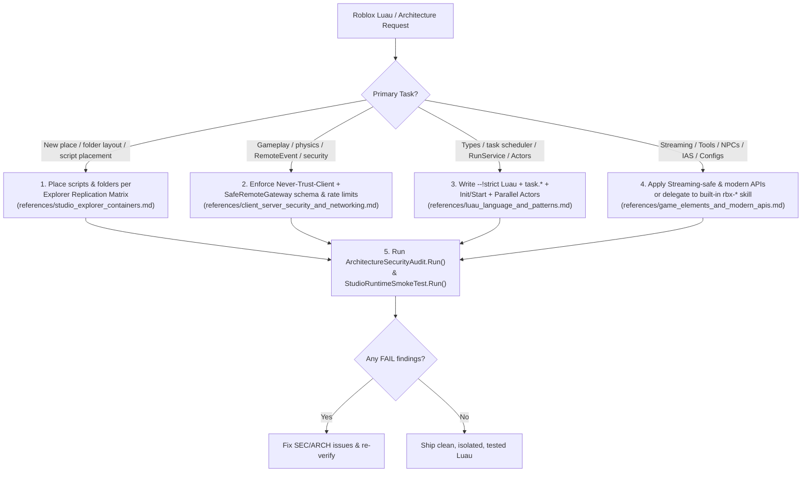
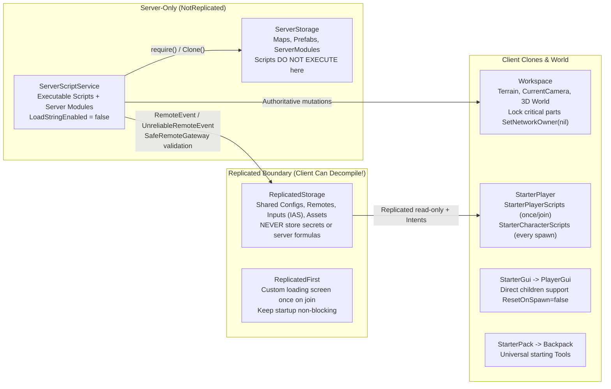

# Roblox Luau Coding & Explorer Architecture

Production engineering guide for Roblox-specific **Luau** (`--!strict`, `task.*`, `buffer`, `Actor` Parallel Luau, `RunService` step hooks), **Studio Explorer container boundaries**, **Zero-Trust client-server security**, and **modern engine APIs**.

---

## 1. Workflow Decision Tree

---

## 2. Client-Server Trust & Explorer Container Boundary

---

## 3. Non-Negotiable Guardrails

1. **`ServerStorage` Never Runs `Script`s:** Keep executable server `Script`s in `ServerScriptService` and passive assets/maps/`ModuleScript`s in `ServerStorage`.
2. **Everything Replicated Can Be Decompiled:** Even disabled `LocalScript`s and **unrequired `ModuleScript`s** inside `ReplicatedStorage` or `Workspace` are readable by exploiters. Never mix server-only logic or secrets into replicated `ModuleScript`s.
3. **Never Trust the Client:** Validate every remote payload (`typeof`, finite numbers rejecting `NaN`/`±math.huge`, bounds, non-mixed non-sparse tables), distance (`<= 500` studs for gameplay raycasts), cooldowns, and permissions on the server. Set `basePart:SetNetworkOwner(nil)` on server-owned NPCs, hazards, and projectiles, and keep `ServerScriptService.LoadStringEnabled = false`.
4. **Remote Hygiene:** Use `RemoteEvent` for reliable intents, `UnreliableRemoteEvent` (strictly `<= 1,000` bytes, unordered) for ephemeral cosmetics/telemetry, and **NEVER call `RemoteFunction:InvokeClient()` in production** (hang/error vector).
5. **Modern Luau First:** Always open new scripts with `--!strict`, replace banned globals (`wait`, `spawn`, `delay`, lowercase `Wait`) with `task.wait` / `task.spawn` / `task.defer` / `task.delay` / `task.cancel`, use generalized iteration (`for k, v in t do`), `table.freeze`/`table.clone`, and `RunService` step hooks (`PreRender`, `PreAnimation`, `PreSimulation`, `PostSimulation`, `Heartbeat`).
6. **Parallel Luau Rule:** Put parallel workers under dedicated `Actor`s, communicate via `Actor:SendMessage` / `BindToMessage` / `BindToMessageParallel` and `SharedTable` / `SharedTableRegistry`, and **never call `require()` during `task.desynchronize()`** (require dependencies first in serial phase).
7. **`StreamingEnabled` + `CollectionService` Trap:** Streamed-out instances parent to `nil`. When instances stream back in (or server tags change), server `CollectionService` tags overwrite client-local tags. Keep startup critical paths (`ReplicatedFirst`, loading flow) non-blocking with `FindFirstChild` + `nil` checks rather than `WaitForChild`.
8. **`StarterGui` Persistence Rule:** `ScreenGui.ResetOnSpawn = false` only persists across respawns when placed as a **direct child** of `StarterGui` (not nested inside a `Folder`).

---

## 4. Verification & Built-In Studio Skill Routing

Before authoring major subsystems in Roblox Studio, route to the built-in Studio skill when applicable:

| Topic | Invoke Built-In Studio Skill | Local Reference / Tool |
|---|---|---|
| Keyboard, mouse, gamepad, touch controls (IAS) | `rbx-input-action-system` | [game_elements_and_modern_apis.md](references/game_elements_and_modern_apis.md) |
| Converting / fixing `StreamingEnabled` worlds | `rbx-convert-to-streaming` | [game_elements_and_modern_apis.md](references/game_elements_and_modern_apis.md) |
| Live-ops constants, feature flags, A/B tests (`ConfigService`) | `rbx-configs-experimentation` | [game_elements_and_modern_apis.md](references/game_elements_and_modern_apis.md) |
| Scene memory, unparented leaks (`SceneAnalysisService`) | `rbx-scene-analysis` | [game_elements_and_modern_apis.md](references/game_elements_and_modern_apis.md) |
| Heap leaks, CPU spikes, network throttling | `rbx-luau-heap-profiling` / `rbx-perf-profiling` / `rbx-network-simulator` | [luau_language_and_patterns.md](references/luau_language_and_patterns.md) |
| Developer Product `ProcessReceipt`, analytics, tests | `rbx-process-receipt-misuse` / `rbx-instrument-analytics` / `rbx-unit-test` | [game_elements_and_modern_apis.md](references/game_elements_and_modern_apis.md) |

---

## 5. Execution & Toolchain Workflow via `Sharp` MCP

1. **Concept Intake Questions, Micro-MVP & Sub-Agent Delegation (`sharp_game_plan`)**: Before creating plans or writing code, call `sharp_game_plan(action="intake_questions")` to clarify visual theme, combat feel, and MVP boundaries with the user. Create a micro-step plan via `sharp_game_plan(action="create", granularity="micro")` so features land and verify in tiny slices (`S2.1` single attack -> test -> `S2.2` single block -> test -> `S2.3` target dummy + audio/video) before unlocking post-MVP stages (`S3`/`S5`/`S6`). Use `next_step.subagent_brief` or `action="subagent_brief"` to delegate Art, 3D Assets, Micro-Slices, and Vision QA cleanly to specialized sub-agents.
2. **Scaffold, Inspect & Edit (`sharp_luau_scaffold`)**: Apply or clean up the canonical Explorer folder layout (`action="apply"|"cleanup"`, `ProjectScaffold.Apply`), wire `--!strict` `SafeRemoteGateway` validation and `InputActionSystem` stubs, or inspect/update live Studio trees and scripts via `action="search_tree"|"inspect_instance"|"read_script"|"update_script"` (`SharpTreeTools`, returning compact summaries with `SnapshotViewStore` pagination via `sharp_inspect_snapshot_view`).
3. **Multimodal Playtest/Animation/Sound/Vision QA (`sharp_media_qa`)**: Inspect playtest/animation video recordings (`action="inspect_video"`), soundtest `.wav`/`.mp3`/`.ogg` assets (`action="inspect_audio"`), and UI screenshots (`action="inspect_gui_vision"`) via Gemini/OpenRouter + local DSP/contact-sheet checks before marking micro-steps complete.
4. **Adversarial Critical Audit (`sharp_critical_audit`) & Legacy Audit (`sharp_audit_all`)**: Run `sharp_critical_audit(mode="static"|"live"|"challenge"|"gate")` for tokenizer-backed Luau checks (ignoring comments/strings), GUI/animation/world/plan cross-checks, map overlap checks (`WORLD-OVERLAP-001`), 100-player/phone/rejoin challenge probes, and `SHIP`/`FIX_FIRST`/`REJECT` verdicts. Use `sharp_audit_all` for direct DataModel scripts (`ArchitectureSecurityAudit.Run()`, GUI, Environment, Console Logs).
5. **Local Open-Source Toolchain (`sharp_toolchain`)**: Detect installed **Rojo**, **Lune**, **Selene**, **StyLua**, **Wally**, and **Rokit** binaries, generate or update `default.project.json` (mapping `ReplicatedStorage`, `ServerScriptService`, `StarterPlayer`, `StarterGui`, and `SharpAssetRegistry.luau`), and run offline headless checks (`stylua --check`, `selene`, `lune run`) with structured pass/fail diagnostics.

---

## 6. References & Scripts Index

### Deep References (`references/`)
- [studio_explorer_containers.md](references/studio_explorer_containers.md) — Complete guide to all **15 standard Studio Explorer services** (`Workspace`, `Players`, `Lighting`, `MaterialService`, `NetworkClient`, `ReplicatedFirst`, `ReplicatedStorage`, `ServerScriptService`, `ServerStorage`, `StarterGui`, `StarterPack`, `StarterPlayer`, `Teams`, `SoundService`, `TextChatService` + `VoiceChatService`) and replication rules.
- [luau_language_and_patterns.md](references/luau_language_and_patterns.md) — `--!strict` types, generics, `buffer`, `@native`, `task.*` scheduler, `RunService` frame order, `Actor` / `SharedTable` Parallel Luau, `Init`/`Start` modular lifecycle, and Maid/Janitor cleanup.
- [client_server_security_and_networking.md](references/client_server_security_and_networking.md) — Exploiter threat model, `RunContext` rules, network ownership (`SetNetworkOwner(nil)`), `RemoteEvent` vs `UnreliableRemoteEvent` vs `RemoteFunction`, engine table serialization traps, and gateway validation.
- [game_elements_and_modern_apis.md](references/game_elements_and_modern_apis.md) — `StreamingEnabled` & `CollectionService` lifecycle, `Tool`s, `PathfindingService`, `DataStoreService` vs `ConfigService`, Input Action System (`InputContext`/`InputAction`/`InputBinding`/`InputActionLabel`), `ProximityPrompt`, and built-in `rbx-*` routing.
- [audit_rules_catalog.md](references/audit_rules_catalog.md) — Complete rule catalog (`LUAU-*`, `GUI-*`, `ANIM-*`, `WORLD-*`, `PLAN-*`, `XCHK-*`, `CHAL-*`), severities (`BLOCKER`..`INFO`), and `SHIP`/`FIX_FIRST`/`REJECT` gate thresholds.

### Production Luau Modules & Smoke Tests (`scripts/`)
- [project_scaffold.luau](scripts/project_scaffold.luau) (`ProjectScaffold`):
  - `ProjectScaffold.GetCanonicalLayout()`, `ProjectScaffold.Apply(options?)`, `ProjectScaffold.Cleanup(options?)` — idempotent Explorer folder scaffolding with isolated `rootPrefix` and `CollectionService` `tag` cleanup.
- [safe_remote_gateway.luau](scripts/safe_remote_gateway.luau) (`SafeRemoteGateway`):
  - `SafeRemoteGateway.Create(remotesFolder?, options?)`, `SafeRemoteGateway.ValidateField(...)`, `SafeRemoteGateway.ValidateArgs(...)`, `RegisterReliable`, `RegisterUnreliable`, `ConsumeRateLimit`, `SimulateIncoming`, `BindPlayerCleanup`, `Destroy` — typed schema validation + per-player token-bucket rate limiting.
- [architecture_security_audit.luau](scripts/architecture_security_audit.luau) (`ArchitectureSecurityAudit`):
  - `ArchitectureSecurityAudit.Run(options?)` — read-only DataModel auditor emitting structured `PASS` / `WARN` / `FAIL` findings (`SEC-01`..`SEC-06`, `ARCH-01`..`ARCH-04`).
- [studio_runtime_smoke_test.luau](scripts/studio_runtime_smoke_test.luau) (`StudioRuntimeSmokeTest`):
  - `StudioRuntimeSmokeTest.Run(deps?)` — isolated verification runner testing scaffolding idempotency, `SafeRemoteGateway` validation + rate limiting, `ArchitectureSecurityAudit` fixture detection, `CollectionService` + `Attribute` signals, `Actor` / `SharedTable` Parallel Luau, and complete cleanup.
