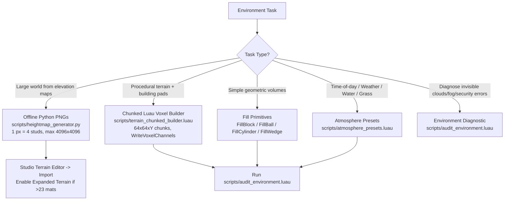

# Roblox Terrain & Atmosphere

Build coherent, streaming-safe Roblox landscapes and outdoor lighting systems without hitting engine voxel caps, `RobloxScriptSecurity` crashes, or silent parenting failures.

> [!NOTE]
> A compact Studio companion skill `roblox-terrain-atmosphere-workflow` covers interactive Studio MCP execution rules (snapshotted/restored edits, Studio UI steps for `Expanded Terrain` and `Lighting.Technology`).

## Decision Tree: Choosing the Right Environment Workflow

## Non-Negotiable Engine Guardrails (Read Before Writing Code)

1. **4x4x4 Voxel Grid & Chunk Budget**:
   - Every terrain cell is `4x4x4` studs within `Terrain.MaxExtents` (`-32000..32000` cells = `-128,000..128,000` studs).
   - Always grid-align regions via `region:ExpandToGrid(4)` before `ReadVoxels` / `WriteVoxels` / `WriteVoxelChannels`.
   - Hard cap is **`4,194,304` voxels per call**. Split larger builds into `64x64xY` voxel columns (`256x256` studs XZ) and `task.wait()` between chunks.
   - 3D voxel tables index `[x][y][z]` and require `materials.Size = Vector3.new(sx, sy, sz)`.
2. **Water & Liquid Occupancy (`WriteVoxelChannels`)**:
   - `Enum.Material.Water` is **invalid** in the `"SolidMaterial"` channel. Write water via `"LiquidOccupancy"` (`0..1`) paired with `"SolidMaterial" = Air` and `"SolidOccupancy" = 0` (solids with occupancy `> 1 - 1/256` cannot hold liquid).
   - Never pass both `"SolidMaterial"` and `"SolidMaterialIndex"` in the same `WriteVoxelChannels` call.
3. **Flatten Zones & `StreamingEnabled` Thickness**:
   - Blend procedural terrain into smoothstep plateaus (`ApplyFlattenZones`) or call `StampBuildingPad` **before** placing spawns, buildings, or NPCs so props neither float nor clip underground.
   - Keep terrain ridges, floors, and islands **`>= 16` voxels (`64` studs) thick**; thinner terrain risks disappearing on clients with `StreamingEnabled = true` and low `StreamingMinRadius`.
4. **Two `RobloxScriptSecurity` Traps (Never Write From Scripts)**:
   - **`Lighting.Technology`** (`RobloxScriptSecurity` on read & write, **deprecated**): never assign it in Luau. Use **`Lighting.LightingStyle`** (`Enum.LightingStyle.Realistic | Soft`) and **`Lighting.PrioritizeLightingQuality`** (`boolean`), or switch Technology manually via Studio UI wrapped in `pcall` on reads.
   - **`MaterialService.Use2022Materials`** (`RobloxScriptSecurity` on read & write): never assign it in Luau; read only inside `pcall`. Use `MaterialService:SetBaseMaterialOverride()` or `MaterialVariant`s instead.
5. **Silent Parenting & Property Coupling Failures**:
   - **`Clouds` ONLY renders when parented directly under `Workspace.Terrain`** (`Lighting.Clouds` is invisible!).
   - **`ColorGradingEffect` (`TonemapperPreset`) ONLY renders when parented directly under `Lighting`** (ignored under `Workspace.CurrentCamera`), and only the most recently parented instance takes effect.
   - **`Atmosphere` suppresses legacy `Lighting.FogStart`/`FogEnd`/`FogColor`** whenever present under `Lighting`.
   - **`Atmosphere.Glare > 0` requires `Haze > 0`**, and **`Atmosphere.Decay` requires BOTH `Haze > 0` AND `Glare > 0`**.
   - `Workspace.GlobalWind` drives terrain `Grass` blades (`Terrain.Decoration = true`, `GrassLength = 0.1..1.0`), `Clouds`, `Fire`/`Smoke`, and `ParticleEmitter`s (`WindAffectsDrag = true`, `Drag > 0`).
   - `CopyRegion` / `PasteRegion` `TerrainRegion` instances **do NOT replicate** automatically between server and client.
6. **Expanded Terrain Custom Materials**:
   - Enables up to `62` paintable slots (`2..63`; `0..1` reserved for `Air`/`Water`) via `Terrain:SetMaterialSlot()`.
   - Must be toggled on `Workspace` -> **Expanded Terrain** -> **Enabled** in Studio Properties, followed by reopening the place (~15s exit/rejoin delay in Team Create). Note that custom terrain `PhysicalProperties` are not respected on Terrain.

## Core Execution Workflow

1. **Choose terrain method**:
   - For script-generated worlds with plateaus/roads/water: require [terrain_chunked_builder.luau](scripts/terrain_chunked_builder.luau) (`TerrainBuilder.BuildRegion(config)`), configuring `FlattenZones` for every spawn/architecture pad and `WaterLevel`.
   - For artist-edited or giant world maps (`<= 4096x4096` px = `16,384x16,384` studs): run [heightmap_generator.py](scripts/heightmap_generator.py) to emit paired PNG heightmap + exact-RGB Roblox colormap + manifest JSON, then import via Studio Terrain Editor.
   - For quick greybox cavities, water basins, or craters: use `FillBlock`, `FillBall`, `FillCylinder`, `FillWedge`, `FillRegion`, or `ReplaceMaterial` (details in [voxel_apis_and_chunking.md](references/voxel_apis_and_chunking.md)).
2. **Apply Atmosphere, Clouds, Sky, Water, Wind & PostFX**:
   - Call `AtmospherePresets.SnapshotEnvironment()` first when iterating so changes remain reversible via `RestoreEnvironment()`.
   - Apply one of `DaylightMeadow`, `GoldenSunset`, `StormyCoast`, `MoonlitNight`, or `VolcanicAsh` via `AtmospherePresets.ApplyPreset(...)` in [atmosphere_presets.luau](scripts/atmosphere_presets.luau).
   - Optionally animate gusts with `AtmospherePresets.StartWindGustLoop(baseWind, gustVector)`.
3. **Audit & Visually Verify**:
   - Run [audit_environment.luau](scripts/audit_environment.luau) (or `sharp_audit_all`) — returns JSON `{ status, passCount, warningCount, errorCount, passes, warnings, errors, metrics }` to confirm zero errors (`Clouds` under `Terrain`, valid `Atmosphere` coupling, `ColorGradingEffect` under `Lighting`, safe `pcall` reads, terrain voxel count, and streaming thickness notices).
   - Capture viewport screenshots across daytime/preset angles to verify horizon blend, water reflectance, grass sway, and building pad alignment.
4. **Sharp MCP Execution**:
   - When connected through **Sharp**, run `sharp_terrain_build` for chunked terrain/flatten zones and `sharp_environment_apply` for atmosphere, clouds, wind, and post-effects inside an atomic `SharpUndo` recording.

## References & Scripts Index

### Reference Guides
- [voxel_apis_and_chunking.md](references/voxel_apis_and_chunking.md) — `4x4x4` grid math, `MaxExtents`, `4,194,304` voxel cap, `[x][y][z]` indexing, `WriteVoxels` vs `WriteVoxelChannels` (`LiquidOccupancy`, `SolidMaterialIndex`), fill primitives, `CopyRegion`/`PasteRegion` non-replication.
- [heightmaps_biomes_and_ai_workflows.md](references/heightmaps_biomes_and_ai_workflows.md) — `1 px = 4 studs` scale, max `4096x4096`, full 23-material official RGB/Hex colormap table, ridge/fBM synthesis, smoothstep flatten zones, and `StreamingEnabled` `>= 16`-voxel thickness rule.
- [custom_materials_and_water.md](references/custom_materials_and_water.md) — Expanded Terrain toggle + reopen/Team Create workflow, `SetMaterialSlot(2..63)`, `MaterialService` `MaterialVariant` + `TerrainDetail` (max `3` faces), `Use2022Materials` `RobloxScriptSecurity`, `SetMaterialColor`, animated grass & water tuning.
- [lighting_atmosphere_sky_postfx.md](references/lighting_atmosphere_sky_postfx.md) — `Lighting.Technology` deprecation/security vs `LightingStyle`, `Atmosphere` (`Haze`/`Glare`/`Decay`/`Offset`), `Clouds` under `Terrain`, `Sky` orientation limits, `GlobalWind`, and `PostEffect` global/camera scope (`ColorGradingEffect`, `BlurEffect`, `SunRaysEffect`).

### Reusable Scripts & Tools
- [terrain_chunked_builder.luau](scripts/terrain_chunked_builder.luau) — Strict Luau `TerrainBuilder` module (`BIOME_PALETTES`, `AlignRegionToGrid`, `ComputeVoxelCount`, `ResolveBounds`, `ApplyFlattenZones`, `SampleHeightFbm`, `ResolveSlopeMaterial`, `BuildRegion`, `StampBuildingPad`, `ClearRegion`).
- [heightmap_generator.py](scripts/heightmap_generator.py) — Offline CLI tool (`ROBLOX_COLORMAP_PALETTE`, `BIOME_PROFILES`, `check_dependencies`, `synthesize_heightfield`, `classify_biome_colormap`, `validate_colormap_colors`, `generate_terrain_maps`, `main`) with graceful `PIL`/`numpy` checks.
- [atmosphere_presets.luau](scripts/atmosphere_presets.luau) — Strict Luau `AtmospherePresets` module (`Presets`: `DaylightMeadow`, `GoldenSunset`, `StormyCoast`, `MoonlitNight`, `VolcanicAsh`; `GetPresetNames`, `ApplyPreset`, `SnapshotEnvironment`, `RestoreEnvironment`, `StartWindGustLoop`).
- [audit_environment.luau](scripts/audit_environment.luau) — Standalone strict Luau environment diagnostic emitting `HttpService:JSONEncode(report)` (`status`, `passCount`, `warningCount`, `errorCount`, `passes`, `warnings`, `errors`, `metrics`).
